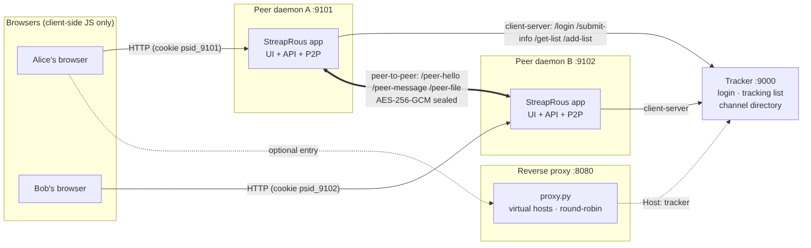
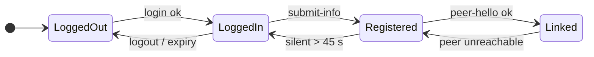
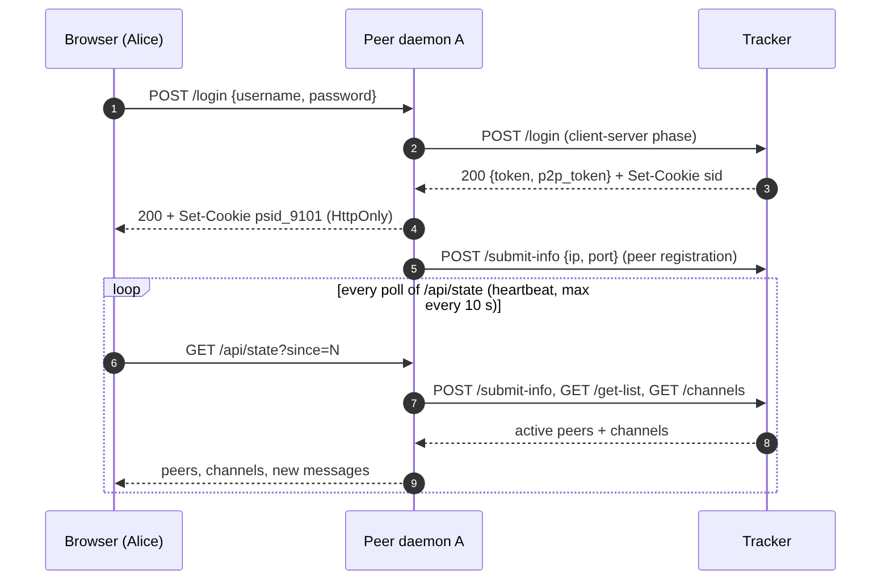
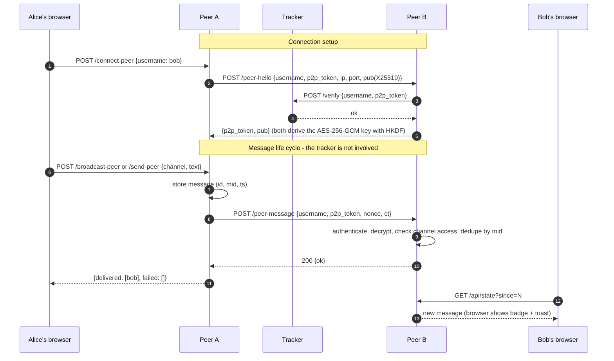
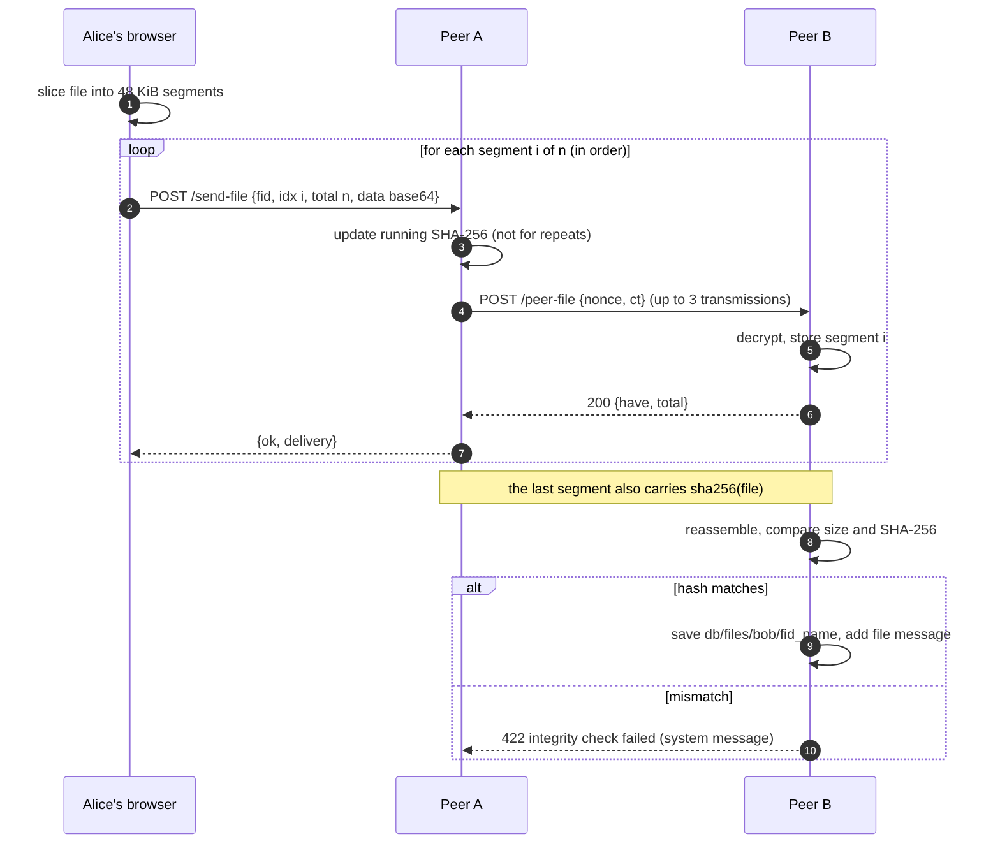
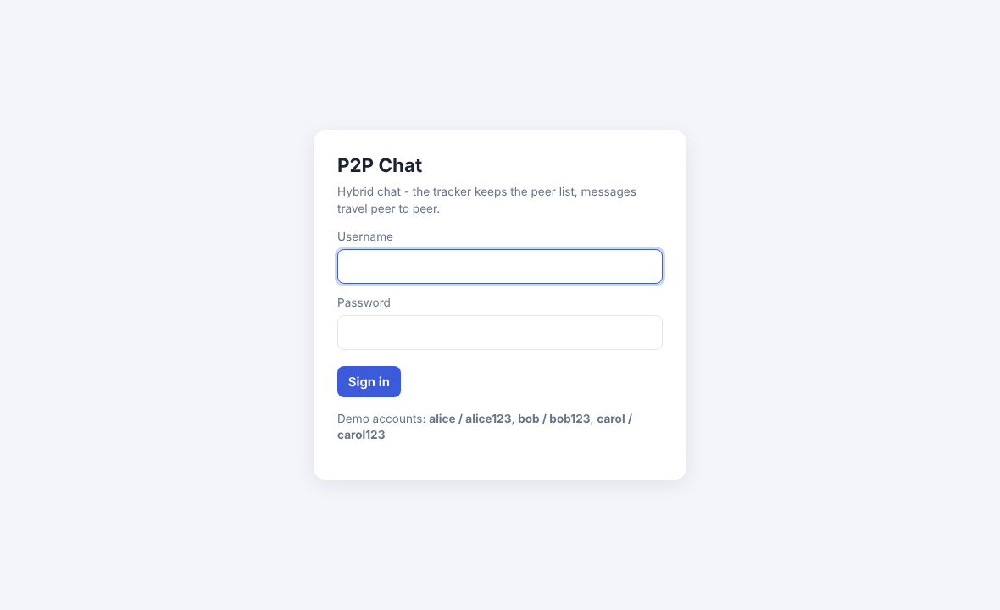
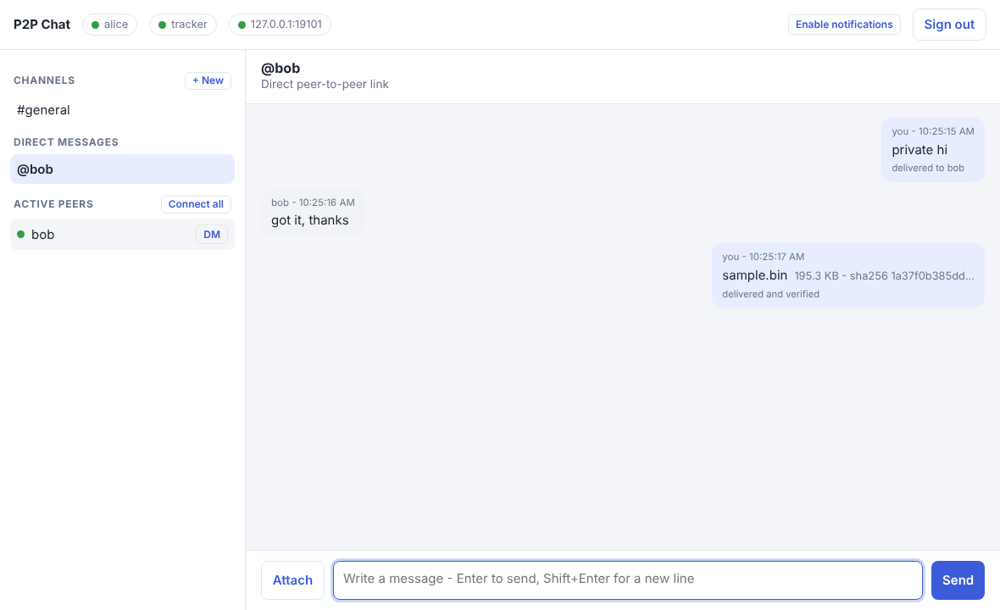
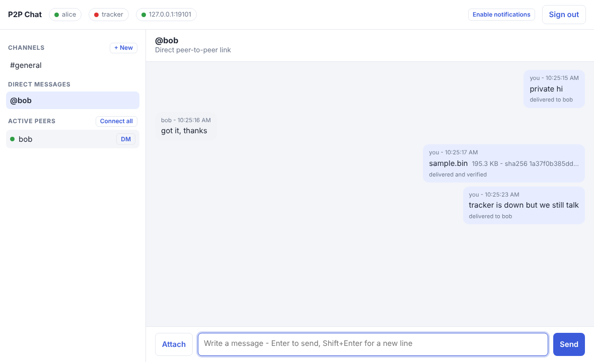

# Technical Explanation Report

**Distributed, stream-based client-server collaboration application - StreapRous P2P Chat**
Course CO3094 - Computer Networks - Assignment 1 - HCMUT

[TOC]

## 1. Overview

The assignment extends the course's *StreapRous* HTTP daemon (proxy, backend and a decorator based
web-application framework) into a **hybrid chat system**. A central **tracker** implements the client-server
paradigm (authentication, list of active peers, channel directory). Live conversations then run **directly
between peer daemons** (peer-to-peer paradigm), so the tracker never sees a chat message.

Delivered on top of the provided skeleton:

* the HTTP core (request parsing, status codes, cookies, HTTP Basic, JSON, static files, proxy with load balancing);
* three server transports: `coroutine` (asyncio, default), `threading`, `raw` (course raw-socket TCP);
* tracker, peer daemon, browser UI (HTML/CSS and **client-side JavaScript only**), file transfer, payload encryption;
* 28 automated tests.

No HTTP framework, no WebSocket: every HTTP message is produced and parsed by the code in `daemon/`.

## 2. System architecture



| Process | Role | Port (default) |
|---|---|---|
| Tracker (`start_chatapp.py --role tracker`) | login, tracking list, channel directory, identity verification | 9000 |
| Peer daemon (`--role peer`) | serves the UI of one user, talks to the tracker and to other peers | 9101, 9102, ... |
| Proxy (`start_proxy.py`) | optional reverse proxy: virtual hosts, `proxy_pass`, round-robin / least-conn / random / ip-hash | 8080 |
| Backend (`start_backend.py`) | plain static HTTP server (also used as a load-balancing target) | 9000.. |

**Separation of concerns** (design requirement): *network logic* = `daemon/` (HTTP, sockets, client, crypto);
*data processing* = `apps/tracker.py`, `apps/peer.py` (state, protocol rules); *user interface* = `www/` + `static/`.
A peer daemon belongs to exactly one user at a time; a browser only ever talks to its own daemon (same origin, no CORS).

**Transports.** `coroutine` runs everything on one asyncio event loop; `threading` uses one daemon thread per
connection on blocking sockets; `raw` uses the course's raw TCP implementation (needs sudo). All three call the same
`HttpAdapter.dispatch()/adispatch()` pipeline, and route handlers may be plain functions or `async def`.

## 3. Protocol specification

### 3.1 Conventions

* HTTP/1.1, one request per TCP connection (`Connection: close`). The body length is given by `Content-Length`;
  the reader keeps receiving until the whole body arrived (limits: header 64 KiB, body 5 MiB) and answers
  `Expect: 100-continue`.
* Bodies are UTF-8 JSON (`Content-Type: application/json`); the login form also accepts
  `application/x-www-form-urlencoded`.
* Success: `{"ok": true, ...}`. Error: `{"ok": false, "error": "<reason>"}` with `400` (malformed), `401` (not authenticated),
  `403` (not allowed), `404`, `405`, `409`, `413`, `422`, `429`, `500`, `502` (peer/backend unreachable), `503`, `504`.
* Authentication: tracker session cookie `sid` (HttpOnly, SameSite=Lax) - also accepted as `Authorization: Bearer <sid>`
  or HTTP Basic (RFC 7617, used for `/admin`); peer daemon cookie `psid_<port>`. State-changing browser calls must send
  `X-Requested-With: fetch` (CSRF defence).

### 3.2 Tracker API (client-server phase)

| Request | Auth | Body | Success response |
|---|---|---|---|
| `POST /login` | - | `{username, password}` | `{ok, username, token, p2p_token, ttl}` + `Set-Cookie: sid` (form post: `302`) |
| `POST /logout` | session | - | `{ok}`, cookie expired, peer removed |
| `POST /submit-info` | session | `{ip, port}` | `{ok, registered, active}` (registration and heartbeat) |
| `GET /get-list[?channel=#c]` | session | - | `{ok, you, peers:[{username, ip, port, age}]}` - only peers seen in the last 45 s |
| `POST /add-list` | session | `{channel, members:[...], private}` | `{ok, channel, owner, private, members}` (creates the channel on first use) |
| `GET /channels` | session | - | channels the caller has joined |
| `POST /verify` | session | `{username, p2p_token}` | `{ok}` - lets a peer check another peer's identity |
| `GET /admin` | HTTP Basic (admin) | - | HTML dashboard; `401` + `WWW-Authenticate: Basic realm=...` otherwise |
| `GET /health` | - | - | `{ok, role, active_peers}` |

Rules: the username always comes from the session, never from the body; only the owner may add other members; a private
channel is invisible to non-members; a user is locked for 15 s after 5 failed logins (`429`).

### 3.3 Peer daemon API (browser side)

| Request | Purpose |
|---|---|
| `GET /` | chat page if logged in, otherwise login page |
| `POST /login` | forwards the credentials to the tracker, registers the peer, sets cookie `psid_<port>` |
| `GET /get-list` | peer discovery (tracker list flagged with `connected`) |
| `POST /connect-peer {username}` or `{all:true}` | open P2P links (connection setup) |
| `POST /broadcast-peer {channel, text}` | message to every member of a channel over the P2P links |
| `POST /send-peer {to, text}` | unicast message (private conversation) |
| `POST /channels {name, members, private}` | channel creation through the tracker's `/add-list` |
| `POST /send-file {channel, fid, name, size, idx, total, data}` | one 48 KiB segment of a file (base64) |
| `GET /download?fid=` | download a received file |
| `GET /api/state?since=N` | peers, channels, new messages, network status; also the heartbeat |

Messages are limited to 2000 characters, immutable once sent, and rendered by the browser with `textContent` (no HTML injection).

### 3.4 Peer-to-peer protocol (peer <-> peer, no cookie)

**`POST /peer-hello`** - link establishment
```json
{"username": "alice", "p2p_token": "9f2c...", "ip": "192.168.1.5", "port": 9101, "pub": "<X25519 public key, base64>"}
-> {"ok": true, "username": "bob", "p2p_token": "41ab...", "pub": "<X25519 public key, base64>"}
```
The receiver asks the tracker (`/verify`) whether `(username, p2p_token)` is a live session and compares `ip:port` with
the tracking list. Both sides derive `key = HKDF-SHA256(X25519(priv, peer_pub), salt = "alice:bob", info = "streaprous-p2p-v1")`.

**`POST /peer-message`** and **`POST /peer-file`** - envelope (everything private is inside `ct`)
```json
{"username": "alice", "p2p_token": "9f2c...", "nonce": "<12 random bytes, b64>", "ct": "<AES-256-GCM, b64>"}
```
Plaintext of a message: `{"channel": "#general" | "dm:alice:bob", "text": "...", "mid": "<uuid>", "ts": 1767225600.1}`.
Plaintext of a file segment: `{"channel", "fid", "name", "size", "idx", "total", "sha256" (last segment only), "data": base64}`.
The associated data of the GCM tag is `"<sender>><recipient>"`.

Receiver checks, in order: sender is linked and the token matches -> decryption/tag -> channel access (a DM must involve both
users; a group channel must list the sender) -> duplicate `mid`. Answers `200`, `400` (bad payload), `403`, `422` (file integrity).

### 3.5 Life cycle (state diagram)



## 4. Sequence diagrams

**Login, registration and discovery**



**Connection setup and the life cycle of a message**



**File transfer** (segmentation, acknowledgement, retransmission, reassembly, integrity check)



## 5. Design decisions

**Non-blocking, no head-of-line blocking.** Each peer-to-peer message or segment is an independent connection and the daemon
sends to all recipients with `asyncio.gather`; a slow or dead peer delays only its own delivery (test:
`test_9_dead_peer_is_reported_not_fatal`). Every outgoing call has a timeout. The browser polls `/api/state` and never blocks.

**Reliability.** Segments are acknowledged one by one (`200 {have,total}`); a refused segment is retransmitted up to 3 times
(only that segment); a repeated segment index overwrites the previous copy, so retransmission is idempotent. The sender
hashes the data once while it streams through and the receiver verifies size and SHA-256 after reassembly.
Messages carry a unique `mid`; duplicates are dropped.

**Security.** Passwords: PBKDF2-HMAC-SHA256 (60 000 rounds, random salt), constant-time compare, login lockout.
Sessions: 192-bit random ids, HttpOnly + SameSite cookies. The id shown to other peers is an *HMAC of the session id*
(`p2p_token`), so a peer cannot log in as another user with it. P2P payloads are encrypted with AES-256-GCM using a per-link
key from an ephemeral X25519 exchange. Static files are served from a fixed root with path-traversal protection and
`nosniff`; filenames of uploads are reduced to a safe basename.

**Resilience.** Malformed requests -> `400`; oversize -> `413`; slow clients -> `408`; handler exceptions -> `500` JSON
(the server keeps running); unreachable peers are removed from the link table and reported to the sender; while the tracker is
down existing links keep working and the UI shows a red tracker indicator.

## 6. User interface







The UI shows the peer list with online/connected state, channels with unread badges, delivery status of every message
("delivered to bob" / "not delivered to carol (offline)"), a progress bar for uploads and the tracker/daemon status.

## 7. Testing

`python -m unittest -v tests.test_e2e tests.test_secure` - 28 tests, executed with both server transports. They launch
the real processes and cover: authentication (cookie, Basic, lockout), access control of private channels, input
validation, discovery, broadcast and unicast, 20 concurrent senders, forged peer requests, plaintext rejection, XSS payloads,
300 kB binary file received byte-for-byte, out-of-order/oversized/forged segments, a peer killed in the middle of a session,
proxy round-robin, `proxy_set_header`, 502/404, large bodies through the proxy. Manual multi-window test (two browsers, three
terminals) is described in the README. The raw transport was checked with a static page only.

## 8. Challenges and solutions

| Challenge | Solution |
|---|---|
| The skeleton read one `recv(1024)`, so any POST with a larger body was cut | `read_http_request` / `read_http_request_async` read until `Content-Length` bytes arrived (and answer `Expect: 100-continue`). |
| Several skeleton bugs (tuple unpack of `None, None`, `routes=None`, coroutine loop that spun forever at EOF, undefined names in `HttpAdapter`) | Rewrote the request/response/adapter pipeline once, shared by all transports, and covered it with tests. |
| Cookies are shared by every port of `localhost`, so two peers in one browser overwrote each other's session | Cookie name includes the daemon port (`psid_9101`). |
| Giving the tracker session id to other peers would let them impersonate the user | A peer shows only an HMAC-derived `p2p_token`; the tracker can verify it but nobody can invert it. |
| A malicious hello could make a daemon connect to an arbitrary address | The advertised `ip:port` must equal the one stored in the tracking list. |
| A dead peer must not freeze a broadcast (head-of-line blocking) | Concurrent sends with timeouts; failures are returned per recipient. |
| `crypto.subtle` is unavailable in browsers on plain HTTP in a LAN, so the page could not hash files | The daemon computes the SHA-256 while the segments stream through it. |
| Raw sockets need root and a real interface, which makes demos hard | `coroutine` and `threading` transports on normal sockets; `raw` kept for the course implementation. |

## 9. Limitations

History is kept in memory only; offline peers do not receive messages later; file transfer uses the framework's stream
(TCP-based) transport instead of UDP datagrams; there is no TLS, and the key exchange is authenticated only through the tracker's
identity check.
