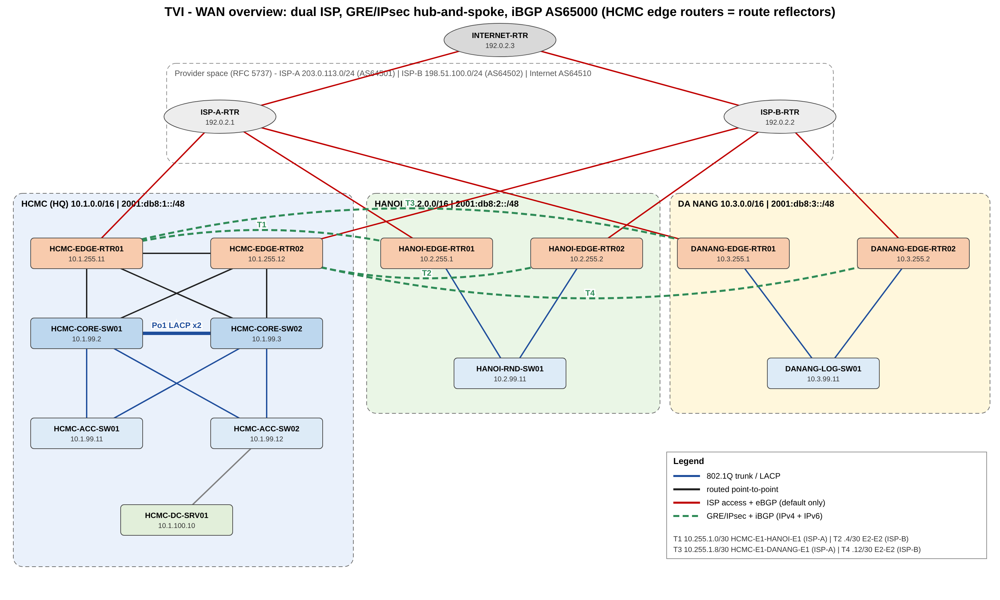
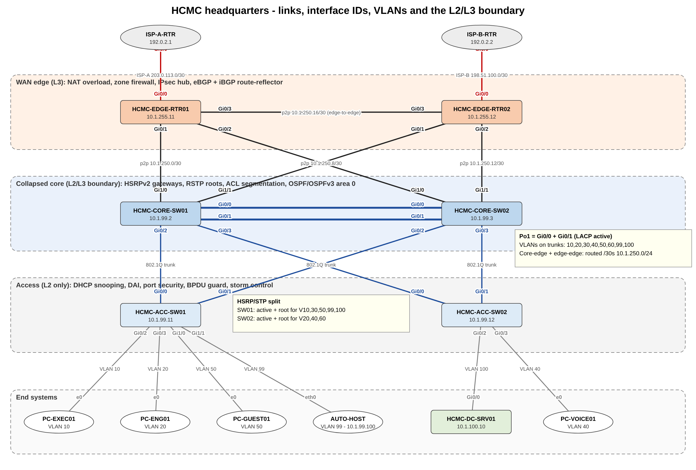
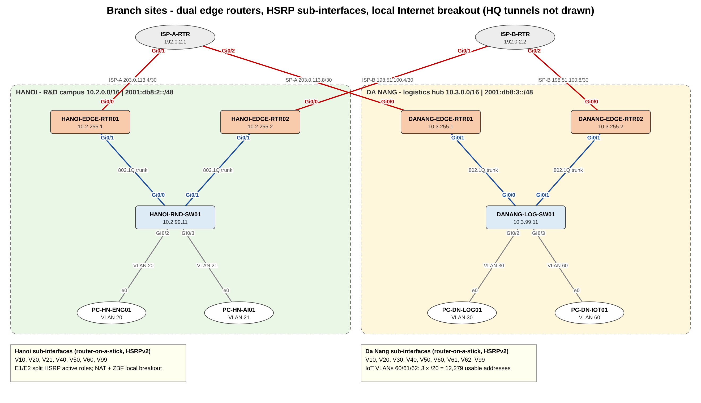
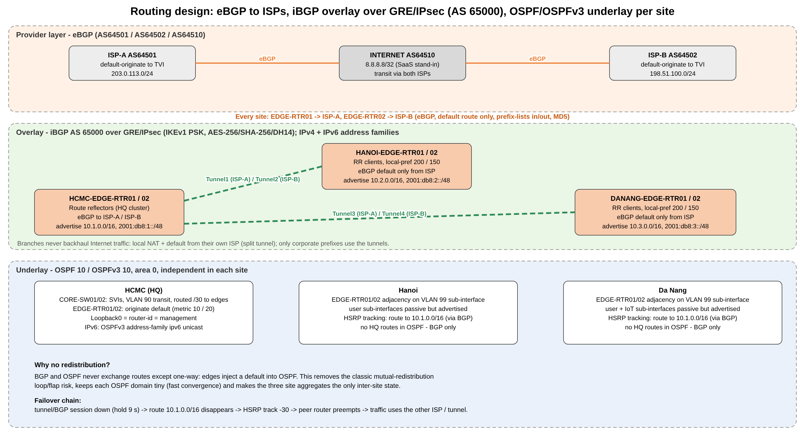

> **Draft v0 (Markdown).** This document is the first draft and is being replaced by the LaTeX report in `Report/latex/`
> (see `Report/REPORT_PLAN.md`). The current design details are in `Docs/`.

# 1. Executive summary

TVI Logistics Tech is growing from 4,000 to 10,000+ users and 10,000+ IoT devices across three sites. The brief asks for a network that (i) has no single point of failure, (ii) gives each branch direct Internet access, (iii) is operated through code instead of console sessions, and (iv) keeps voice/video usable on a congested WAN.

Our design answers these four needs with a **collapsed-core campus at HQ, a dual-ISP IPsec overlay, and an automation toolchain driven from one data model**:

| Business need | Design decision | Where it is shown |
|---|---|---|
| No single point of failure | Two core switches (LACP Po1, HSRPv2 split by VLAN), two edge routers per site, two ISPs, four GRE/IPsec tunnels, eBGP + iBGP route-reflector overlay | Sections 3-5 |
| Direct Internet from branches | Hanoi and Da Nang edges run NAT overload and eBGP to both ISPs; only inter-site/DC traffic uses the tunnels | Section 5.4 |
| Operational agility | One Python data model generates all configs, IP schema, diagrams and inventory; Netmiko/Ansible push a baseline with backup and logging | Section 9 |
| Quality for voice/video | Re-mark at the edge, 4-class LLQ/CBWFQ policy, 20 Mbit/s hierarchical shaper on the WAN | Section 7 |

**Scope statement (honest).** Everything in the repository is generated and statically validated (model and rendered-config consistency tests, mock-based automation tests, and an FRR emulation of the routing design: no overlapping subnets, unique IPs, mirrored link ends, every referenced ACL/policy defined, no clear-text login password in the startup-configs). The configurations were **not** produced by a vendor tool; the EVE-NG/IOSv results in Section 10 are the group's own captures. Items marked **[INSERT ...]** must be replaced with screenshots from your lab before submission.

# 2. Requirements and constraints

| ID | Requirement | Interpretation |
|---|---|---|
| R1 | 3 sites: HCMC HQ (2,000 users now), Hanoi R&D (1,500), Da Nang logistics hub (500 + 10,000 IoT) | Site /16 blocks, capacity for 2030 targets |
| R2 | Segmentation: Exec/Finance, R&D, Logistics, Voice, Guest, IoT, Management | VLANs 10/20/30/40/50/60/99 (+21 AI-lab in Hanoi, 100 DC servers at HQ) |
| R3 | Dual-stack | IPv4 VLSM + IPv6 /48 per site, /64 per VLAN |
| R4 | Redundancy at every layer | LACP, RSTP + HSRP, 2 edges/site, 2 ISPs |
| R5 | Security | ACL micro-segmentation, ZBF, DHCP snooping/DAI/port-security, AAA, SSH only |
| R6 | QoS | Voice/video/signalling priority end-to-end |
| R7 | Automation | Python + YAML inventory, backup before change, error handling, logging |
| R8 | Future-proofing | EVPN-VXLAN, SD-WAN, ZTNA/SASE discussed as roadmap |

# 3. Architecture



**Layering.** Campus = collapsed core (distribution+core in one pair of L3 switches) + access. A three-tier design would add cost and latency without benefit at 2,000 users per site; a separate distribution layer is added only when the access switch count grows beyond what two cores can terminate.







The editable diagram is `Design/TVI_Topology.drawio` (3 pages).

## 3.1 Device inventory

| Site | Devices |
|---|---|
| HCMC | HCMC-CORE-SW01/02, HCMC-ACC-SW01/02, HCMC-EDGE-RTR01/02, HCMC-DC-SRV01 |
| Hanoi | HANOI-EDGE-RTR01/02, HANOI-RND-SW01 |
| Da Nang | DANANG-EDGE-RTR01/02, DANANG-LOG-SW01 |
| Provider / Internet | ISP-A-RTR (AS 64501), ISP-B-RTR (AS 64502), INTERNET-RTR (AS 64510, hosts 8.8.8.8) |
| Management | AUTO-HOST (Linux, VLAN 99) |

Exact cabling is in `Lab/wiring_table.md`.

# 4. Layer 2 and first-hop design

## 4.1 VLANs and trunks
User VLANs terminate on the core SVIs. Trunks use a dedicated native VLAN 998 (no hosts) and unused ports are shut in VLAN 999 (black-hole). Allowed lists are pruned per trunk.

## 4.2 Link aggregation
The two core switches are joined by **Po1 (LACP active)**, 2 x 1 Gbit/s members. LACP was preferred to static ("on") mode because it detects mis-cabling and one-way failures; PAgP is Cisco-proprietary and gives no benefit here.

## 4.3 Spanning tree and HSRP alignment
Rapid-PVST is kept (the access layer is small and the IOSvL2 image supports it); MST would be the choice when VLAN count grows. **STP root and HSRP active are deliberately on the same switch for every VLAN**, otherwise traffic from the access layer crosses the Po1 inter-switch link before it is routed:

| Switch | STP root (priority) | HSRP active (priority 110) | HSRP standby (100) |
|---|---|---|---|
| CORE-SW01 | VLAN 10,30,50,90,99,100 (4096) | same VLANs | VLAN 20,40,60 |
| CORE-SW02 | VLAN 20,40,60 (8192) | same VLANs | VLAN 10,30,50,99,100 |

Root guard on core-to-access ports stops an access switch from ever becoming root. This split also **load-shares** the uplinks (each access switch blocks one uplink per VLAN group).

## 4.4 HSRP rather than VRRP/GLBP
HSRPv2 supports IPv6 and millisecond timers (500 ms hello / 1.5 s hold), interface tracking and MD5 authentication on IOS. VRRP is the multivendor choice and would replace it if the access/core vendor mix changed; GLBP load-balances per host but is not supported for the tracking/IPv6 needs of every image we targeted. Preempt has a 60 s delay so the new active does not take over before OSPF has converged.

## 4.5 Centralised IP services
DHCPv4 (all VLANs, incl. branches), stateless DHCPv6, DNS and NTP live in the HQ data-centre router `HCMC-DC-SRV01` (lab stand-in for a server). Every other L3 interface uses `ip helper-address 10.1.100.10`; branches reach it through the tunnels. Pools are VLAN-specific and exclude `.1-.20`. The guest pool deliberately hands out no internal domain/NTP options.

# 5. Layer 3, WAN and overlay

## 5.1 Underlay - OSPF / OSPFv3
One OSPF process per site, **area 0**, no inter-area complexity: sites are small enough, each site's traffic stays local, and BGP (not OSPF) carries inter-site reachability. Core-edge links are routed /30s on `10.1.250.0/24`. Loopbacks (`10.<site>.255.x/32`) are the router IDs and the BGP/IPsec sources. Edge routers originate the default route as **E1** with different seeds (RTR01 = 10, RTR02 = 20), so the core always prefers RTR01 while it holds an ISP-A path and fails over to RTR02 otherwise. `auto-cost reference-bandwidth 10000` makes Gigabit links distinguishable.

## 5.2 eBGP to the ISPs
Each edge speaks eBGP (TVI AS 65000, a private ASN for the lab) to its ISP. Inbound: accept default only (prefix-list `PL-ISP-IN`). Outbound: advertise nothing (`PL-NONE-OUT`) - the sites use private addresses behind NAT, so TVI can never become a transit AS. Sessions use MD5 passwords and 3/9 s timers for fast failure detection in the lab (production would use BFD).

## 5.3 Overlay - GRE over IPsec + iBGP route reflector
Four GRE tunnels protected by IPsec (GRE carries IPv4 and IPv6; transport-mode IPsec) (hub = HQ edges, spokes = branch edges):

| Tunnel | Hub | Spoke | Transport |
|---|---|---|---|
| 1 | HCMC-EDGE-RTR01 | HANOI-EDGE-RTR01 | ISP-A |
| 2 | HCMC-EDGE-RTR02 | HANOI-EDGE-RTR02 | ISP-B |
| 3 | HCMC-EDGE-RTR01 | DANANG-EDGE-RTR01 | ISP-A |
| 4 | HCMC-EDGE-RTR02 | DANANG-EDGE-RTR02 | ISP-B |

Hub-and-spoke was chosen over a full mesh: 4 tunnels instead of 12 and one policy point (HQ owns the servers). The cost is that branch-to-branch traffic hairpins through HQ (acceptable for the traffic matrix: R&D <-> HQ, logistics <-> HQ). **DMVPN** (dynamic spoke-to-spoke) is the natural next step and was not used because the IOSv images in the lab have limited NHRP/mGRE scale and it complicates the verification.

Over the tunnels the three sites run **iBGP in AS 65000**. HQ edges are **route reflectors**; spokes are clients, so no full iBGP mesh is needed. `next-hop-self all` on the HQ edges is required because a reflector does not change the next hop of reflected routes. Local-preference 200 on the ISP-A path vs. the default 100 on ISP-B makes primary/backup deterministic. IPsec uses IKEv1 with a pre-shared key, AES-256 / SHA-256 and DH group 14 (IKEv2 + certificates is the production recommendation).

## 5.4 NAT and Internet access
* HQ and branches NAT-overload (PAT) user VLANs to the edge's WAN address, **locally** - this is the "direct breakout" requirement; there is no default route through the tunnel.
* Inter-site and DC traffic is excluded from NAT (route-map/ACL deny) and travels the tunnels.
* Guest traffic reaches the Internet only (ACL denies all RFC 1918 destinations).

# 6. Security design

| Layer | Control | Rationale |
|---|---|---|
| Access L2 | DHCP snooping, Dynamic ARP Inspection, port-security (sticky, restrict), BPDU guard, storm-control, unused ports in VLAN 999 | Stops rogue DHCP, ARP spoofing, loops, MAC flooding |
| Segmentation (L3) | Per-VLAN inbound ACLs on the core SVIs / branch sub-interfaces | Cheapest place to enforce the matrix; stateful needs go to the firewall |
| Perimeter | Zone-based firewall on the edges: INSIDE / OUTSIDE / VPN zones, inspect, drop-by-default towards the router itself | Stateful return traffic, protects the control plane |
| Management | SSH v2 only, VTY ACL (10.x.99.0/24), AAA local (lab) + TACACS+/RADIUS roadmap, banner, `service password-encryption`, enable secret type 5 (type 8/9 where the image supports it), logging to 10.1.99.100, NTP | |
| Secrets | **No plaintext credentials in scripts**: `getpass` / environment variables / Ansible Vault | |

**Segmentation matrix** (what each VLAN may *initiate*, as implemented by the inbound ACL on its gateway; "R" = only replies pass back):

| From \ To | Exec/Finance | Other corporate VLANs (R&D, Logistics, Voice, AI lab) | IoT | DC servers | Management | Guest | Internet |
|---|---|---|---|---|---|---|---|
| Exec/Finance | - | yes | yes | yes | **no** | yes* | yes |
| R&D, Voice, AI lab (ACL-CORP-IN) | R | yes | **no** | yes | **no** | yes* | yes |
| Logistics (ACL-LOGISTICS-IN) | R | yes | yes (manages sensors) | yes | **no** | yes* | yes |
| Guest (ACL-GUEST-IN) | **no** | **no** | **no** | **no** | **no** | - | yes |
| IoT (ACL-IOT-IN) | **no** | **no** | - | DNS/NTP/ping to 10.1.100.10 and MQTT-TLS/HTTPS to the IoT platform 10.1.100.20 only | **no** | **no** | **no** |

\* Guest hosts cannot answer: the guest ACL blocks all RFC 1918 destinations, so a connection started towards guests never completes. This is a known weakness of non-stateful ACLs (see design limits).

The exact ACL lines are in the generated configs (`ip access-list extended ACL-<VLAN>-IN`); the test plan (Lab/Test_Plan.md, step 7) proves both the permitted and the blocked rows.

**Design limits.** Extended ACLs are not stateful (return traffic is allowed through `established` / echo-reply entries). A production design would put a stateful firewall (e.g. an NGFW pair) between the user, guest and server zones; we use ZBF at the edge only.

# 7. Quality of Service

* **Classification & marking** at the first L3 hop / branch ingress: voice RTP -> EF (46), video -> AF31, signalling -> CS3 (24); everything else re-marked to default - **we do not trust DSCP set by end hosts**.
* **WAN egress** (parent/child hierarchical policy): parent `shape average 20000000` (20 Mbit/s circuit emulation); child: LLQ `priority percent 20` for voice, CBWFQ `bandwidth percent 25` video, `5` signalling, `5` network-control, remainder class-default (fair-queue).
* The shaper rate is **below the physical link rate** on purpose - without it the egress queue never builds and the policy has nothing to do. In the lab the links are far faster than 20 Mbit/s, so we create congestion artificially (Test Plan 8.5).
* IPsec: the QoS policy matches the *inner* DSCP, which IOS copies to the outer header by default (`qos pre-classify` is not needed for DSCP-based classes on the tunnel egress interface).
* **Limitations:** priority percent 20 is a policer for voice; real sizing needs a call count x codec bandwidth (G.711 is ~87 kbit/s per call with L2 overhead, more inside IPsec; 20 % of 20 Mbit/s = 4 Mbit/s is therefore roughly 40 simultaneous calls - far below what 10,000 users would need on a real circuit, so a production WAN must be sized from the call model).

# 8. IP addressing

The full plan (every VLAN, link, loopback, tunnel; IPv4 VLSM and IPv6) is in `Design/IP_Schema.md` and `Design/IP_Schema.xlsx` (capacity checks use live Excel formulas).

| Site | IPv4 | IPv6 | Notable sizing |
|---|---|---|---|
| HCMC | 10.1.0.0/16 | 2001:db8:1::/48 | Exec /23, R&D /22, Logistics /22, Voice /22, Guest /23, IoT /22 |
| Hanoi | 10.2.0.0/16 | 2001:db8:2::/48 | R&D /22, AI lab /22, Voice /22 |
| Da Nang | 10.3.0.0/16 | 2001:db8:3::/48 | Logistics /22, IoT 3 x /20 (12,279 usable) |

VLSM rules: largest block first, power-of-two aligned, no VLAN larger than /22 except passive IoT; reserved growth ranges are contiguous so no renumbering is needed before 2030. Each site is one aggregate: **3 routes in the whole BGP table**. The Excel sheet *Capacity check* recomputes usable hosts vs. today's and 2030 demand.

# 9. Automation

`Automation/auto_provision.py` (Netmiko) and `Automation/deploy_baseline.yml` (Ansible) take their device list from `inventory.yaml` and their desired state from `payload.yaml`.

**Flow per device:** connect (SSH) -> `show running-config` backup to `backups/<host>_<timestamp>_backup.cfg` -> push config set (role-based: baseline, VLANs for `core`/`access` roles) -> verify (`show vlan brief` regex) -> optional `write memory` -> backup again -> log. Errors (`NetmikoTimeoutException`, `NetmikoAuthenticationException`, generic exceptions) are caught **per device**, logged to `logs/automation.log` and do not abort the run; exit code is non-zero if any device failed.

Design points:
* Credentials only via env (`TVI_SSH_USER`, `TVI_SSH_PASS`, `TVI_ENABLE_PASS`) or `getpass` - never in files.
* `--dry-run` prints what *would* be sent; `--backup-only` is read-only; `--workers N` parallelises with a thread pool.
* The whole configuration is **idempotent** (IOS accepts the same line twice), so rerunning is safe.
* Unit tests mock Netmiko (`ConnectHandler`) - no devices needed - and cover selection, dry-run, backup naming, timeout/auth handling and VLAN verification.
* The startup-configs themselves are generated by `Tools/gen_configs.py` from the single model `Tools/tvi_model.py`, so IP plan, configs, diagrams and inventory cannot drift apart.

**Why both Netmiko and Ansible?** Netmiko gives full control of error handling/backup logic in ~300 lines and is what the rubric asks for; Ansible gives declarative, vault-protected, idempotent modules (`cisco.ios.ios_config`) and is the form a team would operate. The Ansible playbook could not be syntax-checked in our build environment (collection download blocked), so run `ansible-playbook --syntax-check` in your lab first.

# 10. Verification and results

All commands, pass criteria and screenshot names are in `Lab/Test_Plan.md`. Insert your own evidence below.

| Rubric step | What we prove | Evidence |
|---|---|---|
| L2 | VLANs, trunks, Po1 LACP, STP roots | **[INSERT SCREENSHOT s3_1 ... s3_5]** |
| FHRP / IP services | HSRP active/standby, DHCP leases at all sites, NTP/DNS | **[INSERT SCREENSHOT s4_1 ... s4_7]** |
| Underlay | OSPF neighbours, loopback reachability | **[INSERT SCREENSHOT s5_1 ... s5_6]** |
| Overlay | BGP Established, IPsec SAs, tunnel routes | **[INSERT SCREENSHOT s6_1 ... s6_8]** |
| Security | ACL matrix pass/block, NAT, ZBF, snooping/DAI | **[INSERT SCREENSHOT s7_*]** |
| QoS | Class counters during marked traffic and congestion | **[INSERT SCREENSHOT s8_*]** |
| Automation | Dry run, backups, log, new VLAN, error handling | **[INSERT SCREENSHOT s9_*]** |
| E2E / failover | Pings between sites, convergence measurements | **[INSERT SCREENSHOT s10_*]** |

## 10.1 Failover measurements
Fill in with **your measured values** (lost pings x ping interval).

| Scenario | Expected behaviour | Measured outage | Notes |
|---|---|---|---|
| One Po1 member down | no loss (LACP) | **[__ s]** | |
| CORE-SW01 failure | HSRP standby takes over (hold time 1.5 s + STP rapid) | **[__ s]** | |
| ISP-A failure at HQ | BGP drop (9 s hold) -> OSPF default from RTR02 -> tunnel 2/4 | **[__ s]** | |
| Branch ISP-A failure | BGP/IPsec dead-peer detection -> ISP-B tunnel | **[__ s]** | |

# 11. Advanced technologies - roadmap and design discussion

These are **design-only**: they are not configured in the lab (the IOSv images do not support them), and we say so explicitly.

## 11.1 EVPN-VXLAN data-centre fabric
Replace the HQ data-centre VLAN 100 with a leaf-spine fabric: spines run eBGP underlay (or OSPF), leaves are VTEPs, MP-BGP EVPN carries MAC/IP routes, anycast gateway on each leaf, L3VNI per tenant VRF. Benefits: no STP in the DC, all links active (ECMP), 16 M segments (24-bit VNI) vs. 4,094 VLANs, and VM mobility without stretching L2 broadly. Address space `10.1.128.0/18` is reserved for VTEP loopbacks and tenant VRFs. Illustrative leaf snippet (not tested):

```text
vlan 100
  vn-segment 10100
interface nve1
  no shutdown
  host-reachability protocol bgp
  source-interface loopback1
  member vni 10100
    ingress-replication protocol bgp
evpn
  vni 10100 l2
    rd auto
    route-target import auto
    route-target export auto
```

## 11.2 SD-WAN
A controller-based SD-WAN replaces the hand-built tunnel + BGP overlay by centrally managed policy, per-application path selection (voice over the lowest-jitter path, bulk over the cheapest) and zero-touch provisioning of new branches. In this design it would replace Sections 5.3-5.4 and part of the QoS/automation work; the trade-off is licence cost and controller dependency. We kept the manual overlay because the assignment asks us to demonstrate the underlying mechanisms.

## 11.3 ZTNA / SASE
Replace implicit trust of "being in VLAN 20" by identity- and device-posture-based access to applications through a cloud proxy. Guests and IoT keep network-based isolation; users reach SaaS through a SASE gateway (SWG + CASB + FWaaS) instead of the branch NAT. This changes the branch breakout design from "NAT locally" to "steer to nearest SASE PoP".

## 11.4 Wireless (WLC / CAPWAP)
Campus wireless: lightweight APs in management VLAN 99 build CAPWAP tunnels to a controller pair (HA SSO) in the DC; SSIDs map to VLAN 10/20/50 via dynamic VLAN assignment (802.1X); the guest SSID uses a captive portal, anchored in a DMZ. APs would be PoE access ports with their own port template.

# 12. Challenges and lessons

* **Overlapping address blocks** between "reserved growth" and infrastructure ranges were found by the automated checker (not by eye) and fixed by shrinking the reserved blocks - a reason to keep the plan as data.
* **iBGP route reflection and next-hop**: reflected routes keep the original next-hop, so `next-hop-self all` is required on the reflector.
* **Banner delimiter**: using `^C` literally in a generated file creates a stray character; `#` is safe.
* **YAML**: a `#` inside the banner string is a comment unless the string is quoted.
* **Lab vs. production**: shaping at 20 Mbit/s, 3/9 s BGP timers and local users are lab conveniences.

* **Routing loop through the BGP-free core**: after a single branch-ISP failure the HQ edge had to reach the other edge through a core switch that only knows a default route back to it. Fixed with a direct edge-to-edge link; reproduced and verified in the FRR emulation (`Docs/01_Design_Rationale.md`, section 5).
* **Dead iBGP peer hidden by the Null0 summary**: next-hop tracking kept a failed edge's routes valid; fixed with 3/9 s timers on the edge-to-edge session.
* **HSRP failover delayed** by a symmetric preempt delay and 15 s track polling; **OSPF dead interval of 40 s** on links that do not signal link-down. Both fixed (see the same section).

# 13. Limitations

* Configurations were generated and statically validated; commands unsupported by your IOSv/IOSvL2 build may need removal (record them).
* The ZBF, storm-control and some QoS features behave differently on virtual images.
* Ansible playbook not syntax-checked in our environment.
* EVPN-VXLAN, SD-WAN, ZTNA/SASE and WLC are described, not implemented.
* IKEv1 with PSK and local AAA are for the lab only.

# Appendix A - Repository layout

```text
TVI_Project_GroupXX/
  Report/        this report (.md and .pdf)
  Configurations/ HQ_, Hanoi_, DaNang_Startup_Configs, ISP_Configs
  Automation/    inventory.yaml, payload.yaml, auto_provision.py, deploy_baseline.yml, tests, backups/, logs/
  Design/        IP_Schema.md/.xlsx, TVI_Topology.drawio, img/
  Lab/           EVE-NG_Setup.md, Test_Plan.md, Failover_Demo_Script.md, wiring_table.md, push_configs.py
  PacketTracer_Reduced/  reduced variant (needs instructor approval)
  Tools/         tvi_model.py (single source of truth), gen_configs.py, gen_docs.py, test_model.py
```

# Appendix B - References

Cisco IOS configuration guides (HSRP, OSPF, BGP, IPsec, Zone-Based Firewall, MQC QoS); RFC 2328 (OSPF), RFC 4271 (BGP-4), RFC 4456 (BGP route reflection), RFC 5798 (VRRP), RFC 7348 (VXLAN), RFC 7432 (EVPN), RFC 1918, RFC 5737 (documentation ranges), RFC 3849 (IPv6 documentation prefix). Netmiko and Ansible documentation.
